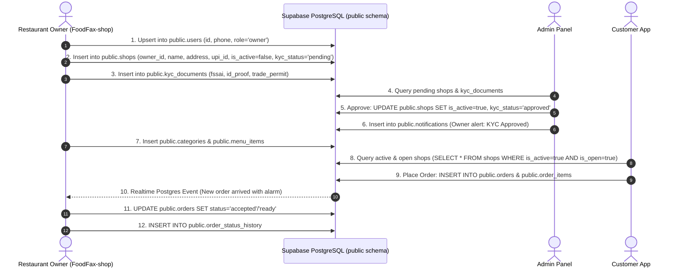

# FoodFax - Database Architecture & Schema Specification

> **Official Database Blueprint for FoodFax Ecosystem (Shop Owner App, Customer App, Admin Panel)**  
> **Target Database Engine:** PostgreSQL 15+ (Hosted on Supabase)  
> **Database Schema:** `public`  
> **Project URL:** `https://aftmqdmiwvpbpsdmsfbu.supabase.co`  
> **Last Updated:** October 2026

---

## 1. Executive Summary & Storage Policy

Sabhi FoodFax apps (Shop Owner App, Customer Ordering App, Delivery App, aur Admin Panel) **ek hi unified Supabase PostgreSQL database** se interact karte hain.

### ⚠️ Strict Rules for All AI Agents & Developers:
1. **No Fragmented Storage:** Shop owner, restaurant, menu, aur order ka data kisi alag/temporary database ya localStorage mock me save **nahi** hona chahiye.
2. **Direct Schema Grounding:** Sirf aur sirf Supabase ke official `public` schema tables (`users`, `shops`, `kyc_documents`, `categories`, `menu_items`, `orders`, `order_items`, `order_status_history`, `notifications`) me data read aur write hoga.
3. **Admin Panel Compatibility:** Shop Owner app ka data Admin Panel par bina kisi conversion ya mismatch ke direct dikhna chahiye, kyunki dono exact same columns aur foreign keys share karte hain.
4. **Egress Optimization:** Har query me indexing, specific column selection, aur pagination limit hona lazmi hai taaki unnecessary egress bandwidth consume na ho.

---

## 2. Feature-to-Table Mapping Matrix

| App Feature / Screen | Frontend Action | Primary Table | Linked Foreign Keys |
| :--- | :--- | :--- | :--- |
| **Owner Registration & Login** | Sign Up / Sign In with Mobile & Password | `public.users` | `users.shop_id` ➔ `shops.id` |
| **Shop Setup / Profile Edit** | Restaurant Name, Type, Address, GPS, Timings, UPI | `public.shops` | `shops.owner_id` ➔ `users.id` |
| **KYC Document Upload** | FSSAI, Aadhaar/PAN, Address Proof, Municipal Permit | `public.kyc_documents` & `public.shops` | `kyc_documents.shop_id` ➔ `shops.id` |
| **Menu Categories** | Create / Edit Food Category (e.g. Chai, Snacks) | `public.categories` | `categories.shop_id` ➔ `shops.id` |
| **Menu Items & Pricing** | Add / Update Dish, Price, Veg/Non-Veg, Available | `public.menu_items` | `menu_items.shop_id` ➔ `shops.id` `menu_items.category_id` ➔ `categories.id` |
| **Orders & Fulfillment** | Accept, Prepare, Ready, Complete, Cancel Order | `public.orders` | `orders.shop_id` ➔ `shops.id` `orders.customer_id` ➔ `customers.id` |
| **Order Details & Items** | Line items inside an order (quantity, price, dish) | `public.order_items` | `order_items.order_id` ➔ `orders.id` `order_items.menu_item_id` ➔ `menu_items.id` |
| **Order Audit & Timeline** | Status transition history for dispute & kitchen audit | `public.order_status_history` | `order_status_history.order_id` ➔ `orders.id` |
| **Customer Notifications** | Push updates when order is accepted/ready | `public.notifications` | `notifications.shop_id` ➔ `shops.id` |
| **Token Counters** | Daily running order token numbers (#001, #002) | `public.shop_token_counters` | `shop_token_counters.shop_id` ➔ `shops.id` |
| **Payment Records** | UPI / Cash / Online transaction records | `public.payments` | `payments.order_id` ➔ `orders.id` |

---

## 3. Detailed Table Schemas

### 1. `public.users` (Owner & User Accounts)
Shop owners aur customers ka unified authentication aur profile table.

| Column Name | Data Type | Constraints | Description |
| :--- | :--- | :--- | :--- |
| `id` | `text` / `uuid` | **PRIMARY KEY** | Unique user ID (Auth UID ya `owner_<phone>`) |
| `phone` | `text` | **UNIQUE**, NOT NULL | 10-digit mobile number with standard `+91` |
| `email` | `text` | NULLABLE | Email address |
| `full_name` | `text` | NOT NULL | Owner ka poora naam |
| `role` | `text` | NOT NULL | Role: `'owner'`, `'customer'`, `'admin'`, `'delivery'` |
| `shop_id` | `text` | NULLABLE, FK ➔ `shops.id` | Linked shop ID |
| `password` | `text` | NULLABLE | Direct auth fallback password |
| `avatar_url` | `text` | NULLABLE | Profile picture URL |
| `profile_completed` | `boolean` | DEFAULT `true` | Setup status |
| `is_active` | `boolean` | DEFAULT `true` | Account active flag |
| `is_demo` | `boolean` | DEFAULT `false` | True for demo accounts |
| `dashboard_layout` | `jsonb` | NULLABLE | Owner dashboard UI widget preferences |
| `created_at` | `timestamptz` | DEFAULT `now()` | Registration timestamp |
| `updated_at` | `timestamptz` | DEFAULT `now()` | Last profile update |

---

### 2. `public.shops` (Restaurant & Food Stall Information)
Restaurant / Food Cart ki primary entity jo Customer App aur Admin Panel par dikhti hai.

| Column Name | Data Type | Constraints | Description |
| :--- | :--- | :--- | :--- |
| `id` | `text` | **PRIMARY KEY** | Unique Shop ID (e.g. `shop_abc123`) |
| `owner_id` | `text` | **NOT NULL**, FK ➔ `users.id` | Owner user ID jo is stall ka malik hai |
| `name` | `text` | NOT NULL | Restaurant / Food Cart ka naam |
| `slug` | `text` | NULLABLE | SEO/URL slug (e.g. `motu-chai-wala`) |
| `stall_type` | `text` | DEFAULT `'Food Stall'` | `'Restaurant / Cafe'` ya `'Food Stall / Cart'` |
| `description` | `text` | NULLABLE | Stall ka brief bio / specialty |
| `phone` | `text` | NULLABLE | Shop contact phone |
| `contact_phone` | `text` | NULLABLE | Secondary contact phone |
| `image` | `text` | NULLABLE | Logo URL / Stall storefront photo |
| `banner_image` | `text` | NULLABLE | Cover banner photo URL |
| `address` | `text` | NOT NULL | Full physical address |
| `area` | `text` | NOT NULL | Neighborhood / Area (e.g. Bandra West) |
| `city` | `text` | NOT NULL | City (e.g. Mumbai) |
| `state` | `text` | NOT NULL | State (e.g. Maharashtra) |
| `pincode` | `text` | NOT NULL | 6-digit postal code |
| `latitude` | `numeric` | NOT NULL | GPS Latitude (PostGIS mapping) |
| `longitude` | `numeric` | NOT NULL | GPS Longitude (PostGIS mapping) |
| `location_accuracy_meters`| `numeric` | NULLABLE | GPS fix accuracy in meters |
| `last_location_updated_at`| `timestamptz` | NULLABLE | Live location ping for mobile carts |
| `is_mobile_stall` | `boolean` | DEFAULT `false` | True if moving food cart / van |
| `upi_id` | `text` | NOT NULL | Merchant UPI VPA (e.g. `name@okaxis`) |
| `opening_time` | `text` | DEFAULT `'10:00 AM'` | Daily opening time |
| `closing_time` | `text` | DEFAULT `'10:00 PM'` | Daily closing time |
| `is_open` | `boolean` | DEFAULT `true` | Real-time live counter open/close toggle |
| `is_active` | `boolean` | DEFAULT `false` | **Admin Verification Flag** (True only after KYC) |
| `is_rush_hour` | `boolean` | DEFAULT `false` | Rush mode (+extra prep time) |
| `table_service_available` | `boolean` | DEFAULT `true` | Accepts dine-in table orders |
| `accepts_delivery` | `boolean` | DEFAULT `false` | Accepts home delivery |
| `delivery_radius_km` | `numeric` | DEFAULT `3` | Maximum delivery distance |
| `delivery_fee_type` | `text` | DEFAULT `'free'` | `'free'` ya `'fixed'` |
| `delivery_fee_amount` | `numeric` | DEFAULT `0` | Flat delivery charge in ₹ |
| `preparation_time_minutes`| `text` | DEFAULT `'10-15'` | Average preparation time |
| `kyc_status` | `text` | DEFAULT `'pending'` | `'pending'`, `'approved'`, `'rejected'` |
| `rejection_reason` | `text` | NULLABLE | Admin rejection note if KYC fails |
| `kyc_documents` | `jsonb` | NULLABLE | Full KYC document metadata payload |
| `fssai_number` | `text` | NULLABLE | 14-digit FSSAI registration number |
| `fssai_doc_url` | `text` | NULLABLE | Storage CDN URL for FSSAI certificate |
| `owner_id_type` | `text` | NULLABLE | `'aadhaar'` ya `'pan'` |
| `owner_id_number` | `text` | NULLABLE | Government ID number |
| `owner_id_doc_url` | `text` | NULLABLE | Storage CDN URL for Aadhaar/PAN |
| `address_proof_type` | `text` | NULLABLE | Proof type (e.g. Electricity Bill) |
| `address_proof_doc_url` | `text` | NULLABLE | Storage CDN URL for Address proof |
| `trade_permit_type` | `text` | NULLABLE | Municipal vendor permit type |
| `trade_permit_number` | `text` | NULLABLE | Municipal registration number |
| `trade_permit_doc_url` | `text` | NULLABLE | Storage CDN URL for Municipal permit |
| `is_demo` | `boolean` | DEFAULT `false` | False for real production vendors |
| `created_at` | `timestamptz` | DEFAULT `now()` | Registration date |
| `updated_at` | `timestamptz` | DEFAULT `now()` | Profile last edited timestamp |

---

### 3. `public.kyc_documents` (Admin Panel Verification Vault)
Admin portal is table se documents ko review karke shop ko approve ya reject karta hai.

| Column Name | Data Type | Constraints | Description |
| :--- | :--- | :--- | :--- |
| `id` | `text` | **PRIMARY KEY** | Document ID (e.g. `kyc_<shopId>_fssai`) |
| `shop_id` | `text` | **NOT NULL**, FK ➔ `shops.id` | Shop reference |
| `document_type` | `text` | NOT NULL | `'fssai'`, `'owner_id'`, `'address_proof'`, `'trade_permit'` |
| `document_name` | `text` | NOT NULL | Human-readable document title |
| `document_number` | `text` | NULLABLE | License or ID number |
| `document_url` | `text` | NOT NULL | Storage CDN or image URL |
| `status` | `text` | DEFAULT `'pending'` | `'pending'`, `'approved'`, `'rejected'` |
| `rejection_reason`| `text` | NULLABLE | Admin feedback on rejection |
| `updated_at` | `timestamptz` | DEFAULT `now()` | Last review timestamp |

---

### 4. `public.categories` (Menu Sections)
Menu grouping (e.g., Fast Food, Chai & Coffee, Chinese, Desserts).

| Column Name | Data Type | Constraints | Description |
| :--- | :--- | :--- | :--- |
| `id` | `text` | **PRIMARY KEY** | Category ID (e.g. `cat_01`) |
| `shop_id` | `text` | **NOT NULL**, FK ➔ `shops.id` | Associated shop |
| `name` | `text` | NOT NULL | Category name |
| `description` | `text` | NULLABLE | Short category description |
| `display_order` | `integer` | DEFAULT `0` | Sort ordering sequence |
| `is_active` | `boolean` | DEFAULT `true` | Visibility toggle |
| `created_at` | `timestamptz` | DEFAULT `now()` | Creation timestamp |
| `updated_at` | `timestamptz` | DEFAULT `now()` | Last updated timestamp |

---

### 5. `public.menu_items` (Dishes & Food Items)
Har shop ka catalog jo Customer App menu screen aur Owner Menu editor par render hota hai.

| Column Name | Data Type | Constraints | Description |
| :--- | :--- | :--- | :--- |
| `id` | `text` | **PRIMARY KEY** | Item ID |
| `shop_id` | `text` | **NOT NULL**, FK ➔ `shops.id` | Shop ownership |
| `category_id` | `text` | NULLABLE, FK ➔ `categories.id`| Linked category |
| `name` | `text` | NOT NULL | Dish name (e.g. Butter Vada Pav) |
| `description` | `text` | NULLABLE | Ingredients / preparation details |
| `price` | `numeric` | NOT NULL | Item selling price in ₹ |
| `image` | `text` | NULLABLE | Food item image URL |
| `is_veg` | `boolean` | DEFAULT `true` | Vegetarian indicator |
| `is_available` | `boolean` | DEFAULT `true` | In-stock / Out-of-stock switch |
| `is_bestseller` | `boolean` | DEFAULT `false` | Bestseller badge flag |
| `preparation_time_min`| `integer` | DEFAULT `10` | Estimated kitchen prep time in mins |
| `preparation_minutes`| `text` | DEFAULT `'10-15'` | Prep time display string |
| `display_order` | `integer` | DEFAULT `0` | Category sorting position |
| `is_active` | `boolean` | DEFAULT `true` | Soft-deletion flag |
| `created_at` | `timestamptz` | DEFAULT `now()` | Creation timestamp |
| `updated_at` | `timestamptz` | DEFAULT `now()` | Last modification |

---

### 6. `public.orders` (Live Order Tracking)
Customer ordering se lekar restaurant kitchen tak order lifecycle track karne wala core table.

| Column Name | Data Type | Constraints | Description |
| :--- | :--- | :--- | :--- |
| `id` | `text` | **PRIMARY KEY** | Unique Order UUID / ID |
| `order_number` | `text` | NOT NULL | Short human-readable code (e.g. `#OD-2841`) |
| `shop_id` | `text` | **NOT NULL**, FK ➔ `shops.id` | Target kitchen |
| `customer_id` | `text` | NULLABLE, FK ➔ `customers.id`| Placed by customer |
| `customer_name` | `text` | NOT NULL | Customer name |
| `customer_phone` | `text` | NOT NULL | Customer contact phone |
| `order_type` | `text` | NOT NULL | `'dine_in'`, `'takeaway'`, `'delivery'` |
| `table_number` | `text` | NULLABLE | Dine-in table tag (e.g. `'Table 3'`) |
| `status` | `text` | DEFAULT `'pending'` | `'pending'` ➔ `'accepted'` ➔ `'preparing'` ➔ `'ready'` ➔ `'completed'` / `'cancelled'` |
| `subtotal` | `numeric` | NOT NULL | Items subtotal in ₹ |
| `tax` | `numeric` | DEFAULT `0` | GST / Taxes in ₹ |
| `discount` | `numeric` | DEFAULT `0` | Applied discount in ₹ |
| `total_amount` | `numeric` | NOT NULL | Net payable amount in ₹ |
| `payment_status`| `text` | DEFAULT `'pending'` | `'paid'`, `'pending'`, `'cod'` |
| `payment_method`| `text` | DEFAULT `'upi'` | `'upi'`, `'cash'`, `'card'` |
| `cancellation_reason`| `text` | NULLABLE | Reason if order is rejected |
| `estimated_prep_minutes`| `integer`| DEFAULT `15` | Kitchen estimated time |
| `created_at` | `timestamptz` | DEFAULT `now()` | Order placed timestamp |
| `updated_at` | `timestamptz` | DEFAULT `now()` | Status update timestamp |

---

### 7. `public.order_items` (Order Line Items)
Har order ke andar ke individual items, quantities, aur specific instructions.

| Column Name | Data Type | Constraints | Description |
| :--- | :--- | :--- | :--- |
| `id` | `text` | **PRIMARY KEY** | Line item ID |
| `order_id` | `text` | **NOT NULL**, FK ➔ `orders.id` | Parent order reference |
| `menu_item_id` | `text` | NULLABLE, FK ➔ `menu_items.id`| Original dish reference |
| `name` | `text` | NOT NULL | Item name snapshot at time of order |
| `price` | `numeric` | NOT NULL | Price snapshot per unit in ₹ |
| `quantity` | `integer` | NOT NULL, >= 1 | Units ordered |
| `is_veg` | `boolean` | DEFAULT `true` | Veg badge |
| `notes` | `text` | NULLABLE | Special customer instructions (e.g. Less spicy) |

---

### 8. `public.order_status_history` (Audit Log)
Har order ke status change hone ka immutable timestamped audit record.

| Column Name | Data Type | Constraints | Description |
| :--- | :--- | :--- | :--- |
| `id` | `text` | **PRIMARY KEY** | Audit entry ID |
| `order_id` | `text` | **NOT NULL**, FK ➔ `orders.id` | Target order |
| `status` | `text` | NOT NULL | New status applied |
| `notes` | `text` | NULLABLE | Operator or kitchen notes |
| `created_at` | `timestamptz` | DEFAULT `now()` | Timestamp of transition |

---

### 9. `public.notifications` (In-App & Push Notifications)
Owner aur Customer alert dispatch queue.

| Column Name | Data Type | Constraints | Description |
| :--- | :--- | :--- | :--- |
| `id` | `text` | **PRIMARY KEY** | Notification ID |
| `user_id` | `text` | NULLABLE | Target recipient phone or user ID |
| `shop_id` | `text` | NULLABLE, FK ➔ `shops.id` | Source shop |
| `title` | `text` | NOT NULL | Notification title |
| `message` | `text` | NOT NULL | Detailed message body |
| `type` | `text` | NOT NULL | `'order_new'`, `'order_status'`, `'kyc_approved'` |
| `is_read` | `boolean` | DEFAULT `false` | Read status |
| `created_at` | `timestamptz` | DEFAULT `now()` | Dispatch timestamp |

---

### 10. `public.shop_token_counters` (Daily Token Numbering)
Counter takeaway aur dine-in orders ke token sequence manage karne ke liye.

| Column Name | Data Type | Constraints | Description |
| :--- | :--- | :--- | :--- |
| `shop_id` | `text` | **PRIMARY KEY**, FK ➔ `shops.id` | Associated shop |
| `current_token`| `integer` | DEFAULT `0` | Running token counter (resets daily) |
| `date` | `date` | DEFAULT `CURRENT_DATE` | Date partition key |

---

## 4. End-to-End Workflow: Data Sync Between Shop, Admin & Customer

---

## 5. Storage Buckets (Supabase Storage CDN)
Files aur documents ko database tables me heavy base64 strings ke roop me save **nahi** kiya jata (jis se egress bandwidth waste hoti hai). Balki Supabase Storage CDN buckets use hote hain:

1. **`kyc-documents`**: PDF aur image documents (FSSAI licenses, Aadhaar/PAN cards, Electricity bills). URL format:
   `https://aftmqdmiwvpbpsdmsfbu.supabase.co/storage/v1/object/public/kyc-documents/<shopId>/<docType>_<timestamp>.jpg`
2. **`shop-assets`**: Restaurant logos, storefront pictures, aur food item menu photos. URL format:
   `https://aftmqdmiwvpbpsdmsfbu.supabase.co/storage/v1/object/public/shop-assets/<shopId>/logo_<timestamp>.jpg`

---

## 6. Checklist for Future Agents & Contributors
- [x] Shop Owner registration writes to `public.users`.
- [x] Shop Setup and updates write to `public.shops`.
- [x] KYC verification files write to `public.kyc_documents` and `public.shops.kyc_documents`.
- [x] Menu items write to `public.menu_items` with foreign keys to `shops.id` and `categories.id`.
- [x] Zero mock / fake / hardcoded vendor data in code.
- [x] Deletion of any record in Supabase immediately propagates and clears local cache.

